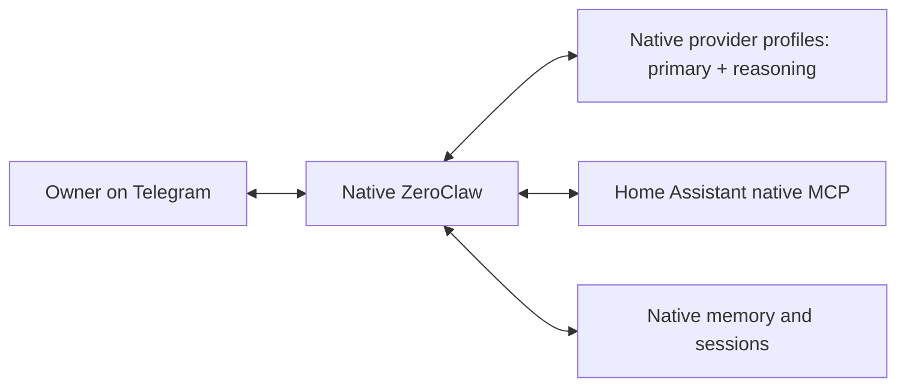

# Architecture: native ZeroClaw + Home Assistant MCP

Decision: native controls, selected by the owner on 2026-11-07. The owner also
authorized rethinking the whole app to simplify it and improve reliability.
Independent Summon Sol and Kimi source reviews both recommend this direction.
Their findings are incorporated below. Real old/new state, native HA/client and
emulated arm64 app checks passed before replacing the legacy source framework.
This is a local implementation; production has not been changed.

## The target

One unprivileged ZeroClaw daemon inside the app. A small startup layer validates
options, prepares persistent state and starts that daemon. There are no custom
HA, provider or Telegram broker daemons in the final native architecture.

- ZeroClaw owns the conversation loop, Telegram polling, model routing,
  tool approvals, memory, sessions and cost accounting.
- Home Assistant owns device control, exposed entities, scripts and automation
  execution. Recurring home behavior stays in Home Assistant.
- The app owns packaging, validated configuration, one-time migration, backups
  and health checks. It does not implement another agent framework.

The target runtime is ZeroClaw 0.8.7, verified as the latest stable release.
Home Assistant 2026.11 is the compatibility target. The installed production HA
version has not been checked or upgraded by this work.

## Home access

Native HTTP MCP connects to Home Assistant's main `/api/mcp` URL. The operator
selects Device control only, disables Expose all AI tools, and enables Read-only
in Home Assistant. A dedicated non-administrator HA account is preferred; the
main endpoint must be configured to permit that account. Individual API URLs
ignore the main endpoint's read-only setting and are not used.

Home access is off until the MCP URL and a new credential are explicitly
configured. Initial qualification is read-only. Shell, general HTTP, browser,
file mutation, delegation and legacy skill tools are not enabled for this agent.
A startup check verifies the expected read-only Device control tool contract;
it is a short-lived check, not an MCP proxy or another runtime service.

Read scope is HA's exposed-entity set. It replaces the old app's independent
exact-ID read filter. The operator reviews that set before enabling native MCP.
The administrative Home Assistant toolset, raw logs and arbitrary action calls
are outside the default configuration.

Supervised device writes are a later qualified mode: explicitly permitted
mutations require native confirmation. The read-only mode must not silently
become a write-enabled mode just because a different server is configured.

## Telegram, providers and assurance

Native Telegram is the only poller. One numeric owner ID is authorized through
native peer groups, with no wildcard or automatic first-user pairing. Private
owner conversation is the intended operating setup; group joining should be
disabled for the bot. Numeric sender authorization is enforced by native
ZeroClaw; a blanket private-chat-only restriction is not claimed where the
pinned runtime does not provide one.

Native provider profiles supply primary and reasoning routes. Native credentials
are readable by ZeroClaw, as intended by its design, in a protected native
configuration. Native cost accounting with complete route pricing and `block`
enforcement replaces the custom durable reservation gateway. Cross-provider/free
fallback is not implicitly enabled.

Bootstrap applies the app options on first use or an explicit options change.
With unchanged options it preserves the native configuration, including native
configuration lifecycle state. The service owns that file with mode 0600;
Supervisor options and the options fingerprint remain root-private. An explicit
app-options edit regenerates the app-managed graph, so that behavior must be
documented instead of implying arbitrary native edits survive a managed reset.
The startup discovery check reads the resulting native configuration, resolves
the default agent's bundle grants and checks its actual MCP URL and credential.
It does not assume saved app options still describe a preserved configuration.
Generated native config explicitly disables same-user secret-file encryption:
the configuration is private (0600 inside 0700) and its daemon owner would also
own the adjacent native decryption key. This keeps effective-config checking
simple without adding custom credential decryption. Encrypted MCP header values
from unsupported manual changes fail startup with instructions to regenerate.

The selected trust model trusts ZeroClaw to enforce its controls. It does not
retain independent enforcement after a runtime compromise, upstream-key
isolation from the runtime, the old hard pre-dispatch spending reservation,
or the old independent actor-bound ticket system. The owner explicitly selected
native controls after these tradeoffs were presented. Do not describe the new
controls as equivalent to those retired mechanisms.

## State and delivery

Keep agent alias `default`, avoiding a custom memory-namespace rewrite. The
native install lives entirely under `/data/native`: its config is
`/data/native/config.toml`, shared state is `/data/native/data`, and workspace
is `/data/native/agents/default/workspace`. That directory is service-owned so
native atomic configuration updates work; Supervisor options and backups stay
root-private outside it. Native workspace and database layout are separate from
the untouched legacy workspace.
Copy known databases through checked migration, then let ZeroClaw perform its
own schema upgrades. Preserve legacy files, audit records and hash-keyed
Telegram JSON as an archive; do not guess sender ownership when importing chat
history. Test actual old and new binaries, restart, idempotence and rollback.

The existing app inventory schema, ZeroClaw TOML schema and runtime layout
version remain distinct. The verified legacy database path is
`workspace/memory/brain.db`; snapshots must include it and SQLite sidecars.

Consume an official pinned ZeroClaw release artifact and verify its archive,
executable and source identity. Build and test the app image on arm64 hardware
or explicit arm64 emulation. Use normal image provenance/signing; do not claim
independent reproduction of the upstream Rust binary unless it was performed.
Production installation remains a separate exact-candidate action.

## Retired runtime machinery

- Custom Telegram watcher, per-turn launcher, callback broker and reply cache.
- HA shell-command catalog, capability listeners and custom MCP facade.
- Provider reservation proxy and bespoke fallback/router implementation.
- Custom ticket seals and approval-transition runtime.
- Generated multi-loop startup scripts, obsolete prompts, duplicate schedulers,
  world-state and learning-loop machinery, and inert feature switches.
- The parallel schema-2 and broker-based schema-3 renderers.

The native replacement passed local qualification before these paths were
retired. The previous implementation and uncommitted work were preserved in a
verified private recovery archive. Only the old executable and its provenance
remain as migration test fixtures, excluded from the shipped image. No parallel
legacy agent framework remains in the app source.

## Evidence and primary references

- Sol review: native Telegram has approval callbacks and per-tool confirmation;
  native budgets differ from durable pre-dispatch reservations; preserve
  `default` instead of introducing the tentative `ha` memory namespace.
- Kimi review independently recommends native-first; it identified the MCP
  `__` auto-admission exception, the need for cost `block` mode and avoiding
  unconditional configuration replacement. Unknown MCP tools require native
  approval; an ordinary risk allowlist does not categorically hide them.
- Actual HA 2026.11 fixture: unauthenticated main MCP returned 401; read-only
  filtered mutators from discovery and dispatch; exposed synthetic state was
  visible while unexposed state was absent.
- Actual ZeroClaw 0.8.7 tests: the x86 native OpenRouter family completed the HA
  MCP call and primary/reasoning/Fusion routing through isolated loopback TLS.
  The emulated arm64 app passed startup, ownership, compatible-provider route,
  graceful restart and SIGKILL recovery checks. These are distinct test scopes.

References:
- https://github.com/zeroclaw-labs/zeroclaw/releases/tag/v0.8.7
- https://www.home-assistant.io/integrations/mcp_server/
- https://www.home-assistant.io/blog/2026/11/04/release-202611/
- `MCP-COMPATIBILITY.md`
